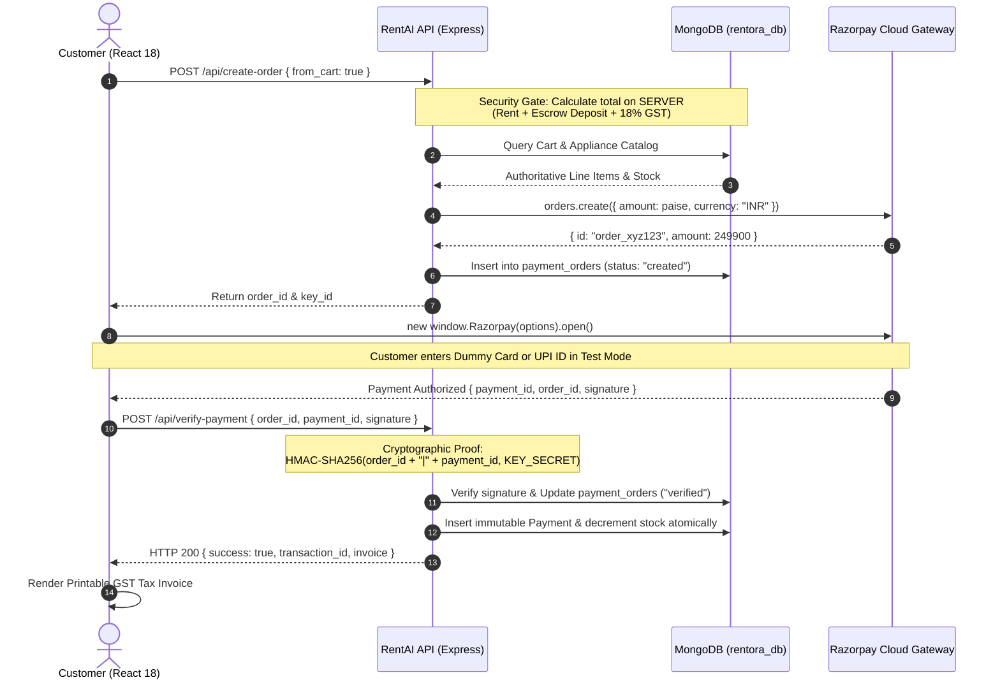

# RentAI (Rentora): Enterprise Razorpay Payment Architecture
## SDC-II Capstone Project Evaluation & Review Panel Presentation Guide

This technical guide details the **Razorpay Standard Checkout Module** integrated into the **RentAI (Rentora)** platform for the **SDC-II (Software Development Cell - II)** capstone evaluation. It provides the exact architectural breakdown, security principles, server-authoritative pricing model, and step-by-step live demonstration instructions for your project review panel.

---

## 1. System Architecture & Industry Parallels

Real-world rental and leasing platforms such as **RentoMojo**, **Furlenco**, and **Airbnb** adhere to strict financial compliance standards (PCI-DSS Level 1, RBI Section 18 Nodal Escrow Regulations).

RentAI adopts the **Razorpay Standard Checkout 2-Tier Architecture**:
1. **Client Tier (React 18 SPA)**: Initiates the lease booking, collects delivery coordination details, and renders the official Razorpay Checkout pop-up overlay (`checkout.js`). No sensitive card numbers or CVVs ever touch our database.
2. **Server Tier (Node.js & Express)**: Calculates the final bill authoritatively from MongoDB catalog data, communicates with Razorpay APIs via the official `razorpay` SDK, issues signed `order_id`s, verifies HMAC-SHA256 signatures, and processes asynchronous webhooks.
3. **Data Tier (Pure MongoDB)**: Stores tamper-evident records across `payment_orders`, `payments`, `rentals`, and `refunds` collections with atomic stock reservation.



---

## 2. Server-Authoritative Price Calculation (Crucial Review Detail)

> **Key Presentation Talking Point**:  
> *"In RentAI, the client browser is considered completely untrusted. The final payable amount is never calculated on the client side. When the customer clicks 'Pay', our backend fetches the active cart directly from MongoDB, recalculates tenure discounts, adds the mandatory refundable escrow deposit and 18% GST, and overrides any client-side tampering."*

### Implementation in [`server/src/routes/payments.js`](file:///c:/Users/dhran/Desktop/RentAI/server/src/routes/payments.js):
```javascript
// Server-Authoritative Price Calculation
if (from_cart || !req.body.amount) {
  const cartItems = await db.collection('carts').find({ user_id: userId }).toArray();
  let totalRent = 0.0, totalDeposit = 0.0;

  for (const item of cartItems) {
    const app = await db.collection('appliances').findOne({ appliance_id: item.appliance_id });
    const pricing = app.pricing || {};
    totalRent += parseFloat(pricing[String(item.tenure || '3')] || app.monthly_price);
    totalDeposit += parseFloat(app.security_deposit || (app.monthly_price * 1.5));
  }

  const taxAmount = Math.round(totalRent * 0.18 * 100) / 100;
  finalAmount = Math.round((totalRent + totalDeposit + taxAmount) * 100) / 100;

  // Security Audit: Detect browser parameter tampering
  if (req.body.amount && Math.abs(parseFloat(req.body.amount) - finalAmount) > 1.0) {
    console.warn(`[Security Alert] Client requested ₹${req.body.amount}, Server recalculation is ₹${finalAmount}. Tampering blocked.`);
  }
}
```

---

## 3. Cryptographic Signature Verification (HMAC-SHA256)

Razorpay returns three values upon successful payment in the browser:
* `razorpay_order_id`
* `razorpay_payment_id`
* `razorpay_signature`

To prevent man-in-the-middle attacks or simulated client payloads, the server mathematically proves the authenticity of the transaction:

$$\text{Expected Signature} = \text{HMAC-SHA256}(\text{order\_id} \parallel \text{"|"} \parallel \text{payment\_id}, \text{RAZORPAY\_KEY\_SECRET})$$

```javascript
// Constant-Time Cryptographic Verification
const bodyToSign = `${razorpay_order_id}|${razorpay_payment_id}`;
const expectedSignature = crypto
  .createHmac('sha256', process.env.RAZORPAY_KEY_SECRET)
  .update(bodyToSign)
  .digest('hex');

const expBuf = Buffer.from(expectedSignature, 'utf8');
const actBuf = Buffer.from(String(razorpay_signature).trim(), 'utf8');

// crypto.timingSafeEqual prevents timing-attack side-channel vulnerabilities
const isValid = (expBuf.length === actBuf.length) && crypto.timingSafeEqual(expBuf, actBuf);
if (!isValid) {
  return res.status(400).json({ error: "Cryptographic signature mismatch. Payment tampering detected." });
}
```

---

## 4. Test Mode & Demo Credentials Cheat Sheet

During your live project evaluation, use these official Razorpay Test Mode credentials to demonstrate payments without requiring real funds or bank accounts:

| Payment Method | Dummy Credential / Identifier | Action / OTP | Expected Result |
| :--- | :--- | :--- | :--- |
| **Credit / Debit Card** | `4000 0000 0000 0002` (or all `4`s) | Any future Exp (e.g. `12/28`), CVV `123`, OTP `123456` | **Instant Success** (3D Secure simulation) |
| **Instant UPI** | `success@razorpay` | None | **Instant Success** (Auto-authorized) |
| **Simulated Decline** | `failure@razorpay` | None | **Decline / Gateway Error Handling** |
| **NetBanking** | Select any bank (HDFC, SBI, ICICI) | Click "Success" on test gateway page | **Instant Success** |

---

## 5. Webhooks & Local Testing with Ngrok

Razorpay communicates server-to-server via webhooks (e.g., `payment.captured`, `payment.failed`, `refund.processed`). To demonstrate live webhooks on your local workstation:

1. **Start RentAI Backend**:
   ```bash
   cd server
   npm run dev
   # Backend listening on http://localhost:8000
   ```

2. **Expose Localhost via Ngrok**:
   ```bash
   ngrok http 8000
   # Generates public forwarding URL: https://abc-123.ngrok-free.app
   ```

3. **Configure Razorpay Dashboard**:
   * Navigate to: **Razorpay Dashboard $\rightarrow$ Settings $\rightarrow$ Webhooks $\rightarrow$ Add New Webhook**.
   * Webhook URL: `https://abc-123.ngrok-free.app/api/payments/webhook`
   * Secret: `rentora_razorpay_webhook_secret_2026`
   * Active Events: `payment.captured`, `payment.failed`, `refund.processed`.

4. **Verify Live Signature**:
   When Razorpay dispatches an event, [`server/src/utils/razorpay.js`](file:///c:/Users/dhran/Desktop/RentAI/server/src/utils/razorpay.js) checks the `x-razorpay-signature` header using HMAC-SHA256, updates MongoDB, and emits a real-time event via WebSocket to the client.

---

## 6. Live Presentation Script (5-Minute Evaluation Walkthrough)

### Step 1: Browse Catalog & Add to Cart
* Open [http://localhost:5173](http://localhost:5173).
* Select an appliance (e.g., *Samsung 4K Crystal UHD TV*), select a **6-Month Plan** (showing tiered pricing discount), and add to cart.

### Step 2: KYC Compliance Verification
* Navigate to `/cart`. Show that RentAI enforces KYC verification.
* Explain to the panel: *"Before entering the payment gateway, customers must clear Aadhaar/Passport proof verification to prevent leasing fraud."*

### Step 3: Trigger Official Razorpay Standard Checkout
* Click **Proceed to Pay**.
* The **Rentora Pay Modal** opens. Click **"Launch Razorpay Checkout"**.
* Show the official Razorpay Checkout pop-up overlaying your application.
* **Explain to the panel**: *"We use Razorpay Standard Checkout. This provides instant PCI-DSS Level 1 security, UPI intent flow, and card tokenization without saving sensitive credentials on our own servers."*

### Step 4: Demonstrate Successful Payment
* Select **Card**, enter dummy card `4000 0000 0000 0002`, expiry `12/28`, CVV `123`.
* Complete the simulated OTP.
* Show the server terminal displaying:
  ```text
  [Razorpay Order Generated] Order: order_... | Amount: ₹2442.82 | Server-Verified: YES
  [Razorpay Signature Verified] Order: order_... | Payment: pay_... | Algorithm: HMAC-SHA256 ✓
  ```

### Step 5: Inspect Tax Invoice & Escrow Ledger
* The application automatically displays the printable **Tax Invoice / Receipt** modal with:
  * Official Razorpay Payment ID (`pay_...`).
  * RBI Nodal Escrow Account allocation for the refundable security deposit.
  * 18% GST tax breakdown (9% CGST + 9% SGST).

### Step 6: Demonstrate Payment Failure Handling
* Initiate another transaction, select UPI, and enter `failure@razorpay`.
* Show that the application gracefully handles the decline without crashing or corrupting cart state.

---

## 7. Verification Test Suites

All tests can be executed locally in the terminal:

```bash
# 1. Run Dedicated Razorpay Test Suite (Order, Signature, Tamper Detection, Webhook, Refund)
python tests/test_razorpay_module.py

# 2. Run Baseline Payment & Return Ledger Test Suite
python tests/test_payment_module.py

# 3. Run End-to-End 14-Step Full Stack System Verification
python tests/test_all_modules_fast.py
```
