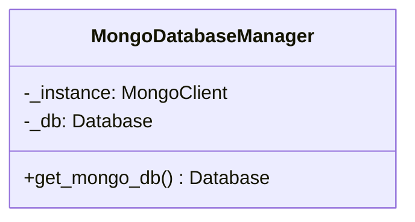
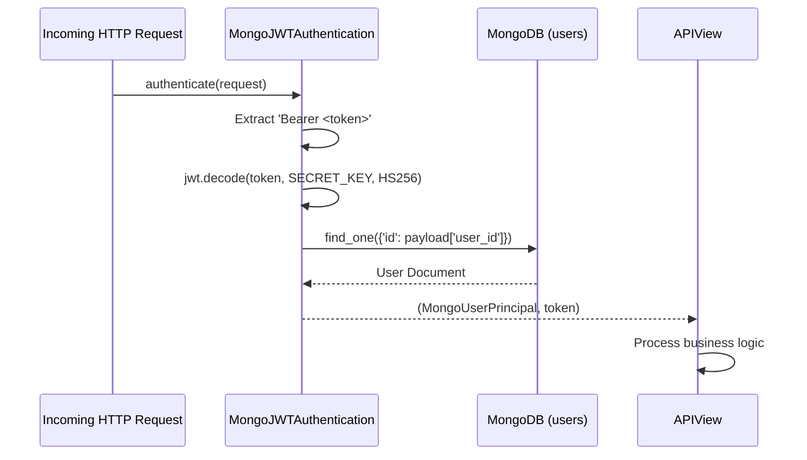
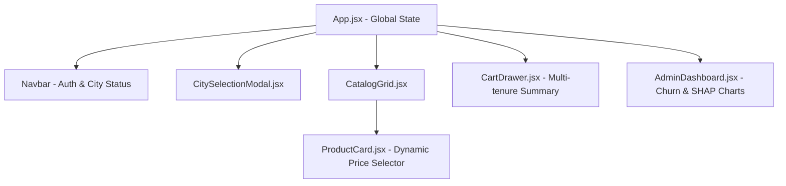

# Software Design Document (SDD – Low Level)
## Project: Rentora – Smart Appliance Rental Platform
**Standard**: IEEE Std 1016-2009 (Software Design Descriptions)  
**Version**: 1.0.0  

---

## 1. Introduction and Module Topology

This Low-Level Software Design Document outlines the detailed class hierarchies, algorithmic workflows, interface contracts, and design patterns utilized in the **Rentora** backend and frontend codebases.

### 1.1 Directory Organization

```
Rentora/
├── server/                        # Backend Node.js & Express 5 Application
│   ├── src/
│   │   ├── app.js                 # Express Application & Middleware Pipeline
│   │   ├── auth.js                # Custom PBKDF2 & JWT Authentication Engine
│   │   ├── db.js                  # Native MongoDB Connection Pool
│   │   ├── socket.js              # Real-Time Socket.io WebSocket Gateway
│   │   └── routes/                # High-Throughput RESTful Controllers
│   └── index.js                   # HTTP Server Entry Point (:8000)
├── ml_pipeline/                   # Data Science & Predictive Analytics Tier
│   ├── etl_pipeline.py            # Behavioral Data Extraction & Vectorization
│   ├── train_model.py             # LightGBM Churn & TF-IDF Recommender
│   ├── train_predictive_maintenance.py # Random Forest AI Telemetry Engine
│   └── evaluate_models.py         # Multi-Model Benchmark Suite
└── frontend/                      # Presentation Tier (React 18 + Vite)
    ├── src/
    │   ├── App.jsx                # SPA Root & Routing
    │   ├── BusinessIntelligenceTab.jsx # Executive BI Dashboard
    │   ├── SmartIoTFleetTab.jsx   # Fleet Telemetry & Refurbishment
    │   └── ...                    # Interactive Views & Modals
```

---

## 2. Design Patterns Implemented

### 2.1 Singleton Pattern: MongoDB Connection Manager
To prevent connection exhaustion and reduce socket initialization overhead, MongoDB connection handles are encapsulated via a thread-safe Singleton pattern with connection pooling in `server/src/db.js` (and `api/mongo_client.py` for Python ML jobs):



```python
# Low-level Singleton Implementation (api/mongo_client.py)
import os
from pymongo import MongoClient

def get_mongo_db():
    uri = os.getenv('MONGO_URI', 'mongodb://localhost:27017/')
    db_name = os.getenv('MONGO_DB_NAME', 'rentora_db')
    client = MongoClient(uri, maxPoolSize=50)
    return client[db_name]
```

### 2.2 Strategy Pattern: Custom JWT Authentication
Rentora implements stateless JWT authentication decoding user credentials on-the-fly (`server/src/auth.js`):



### 2.3 State Pattern: Contract Lifecycle State Machine
Rental contracts evolve through distinct state transitions governed by deterministic transition rules:

| Current State | Permissible Event | Target State | Side Effect |
|---|---|---|---|
| `NONE` | `CHECKOUT_CONFIRMED` | `ACTIVE` | Decrement appliance stock |
| `ACTIVE` | `INITIATE_RETURN` | `RETURNED` | Increment appliance stock; record return date |
| `ACTIVE` | `CONTRACT_EXPIRED` | `OVERDUE` | Alert retention & operations teams |
| `OVERDUE` | `RECOVER_ASSET` | `RETURNED` | Calculate late penalties; replenish stock |

---

## 3. Low-Level Component Specifications

### 3.1 `api/views.py` Controller Implementations

#### `RegisterView` & `LoginView`
- **Responsibilities**: Enforces email uniqueness, hashes passwords with salt, encodes JWT claims (`user_id`, `email`, `role`, `exp`), and sets secure headers.
- **Complexity**: $O(1)$ lookup via unique index on `email`.

#### `ApplianceView`
- **Responsibilities**: Builds dynamic MongoDB aggregation filters (`$and` queries combining `available_cities`, `category_id`, and regex search). Formats tenure price matrices for client rendering.
- **Latency Target**: $\le 100\text{ ms}$.

#### `CheckoutView`
- **Responsibilities**: Validates cart contents against live inventory, executes atomic `$inc` updates on MongoDB stock, calculates total fees and deposits, and commits documents to the `rentals` collection.
- **Transaction Safety**: Guaranteed linearizability using atomic document updates.

#### `AdminDashboardView`
- **Responsibilities**: Fetches high-level KPIs (`users.count_documents()`, `rentals.count_documents({'status': 'ACTIVE'})`), calculates gross recurring revenue, and returns the top customer records sorted by `churn_risk_score` descending.

---

## 4. Frontend Component Hierarchy & State Flow



### 4.1 State Management Mechanics
- **Location State**: Persists chosen operational city (e.g. Bangalore) in LocalStorage and Axios default request headers.
- **Authentication State**: Stores the JWT access token in client memory and session storage, with Axios response interceptors triggering silent token renewal via `/api/token/refresh/` upon receiving a `401 Unauthorized`.

---

## 5. Error Handling & Concurrency Model

1. **Database Connection Failures**: Wrapped with standard retry logic and exponential backoff ($250\text{ms} \to 500\text{ms} \to 1000\text{ms}$).
2. **Stock Exhaustion**: Handled with explicit HTTP `409 Conflict` containing human-readable error messages: `"Requested item has been leased by another user. Stock depleted."`
3. **Invalid Tokens**: Returns standardized HTTP `401 Unauthorized` with `TokenExpiredError` claim.
